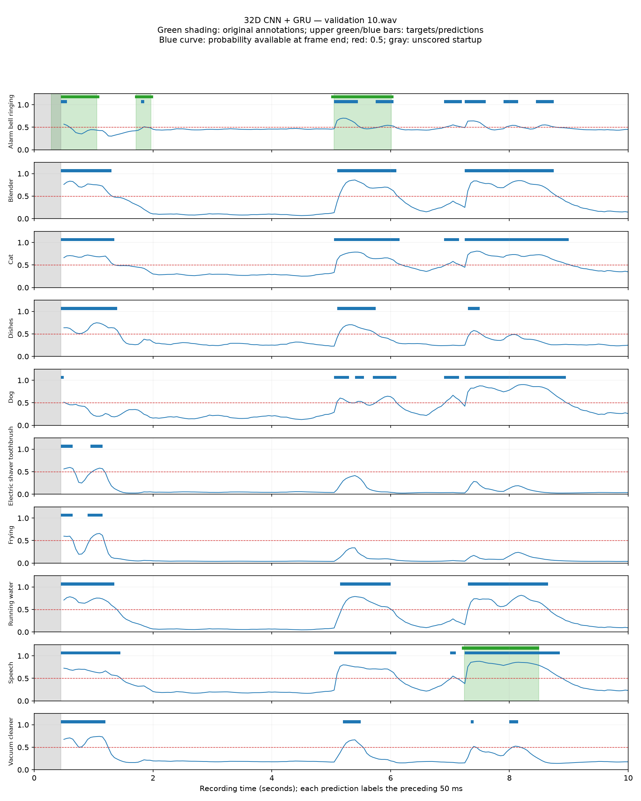
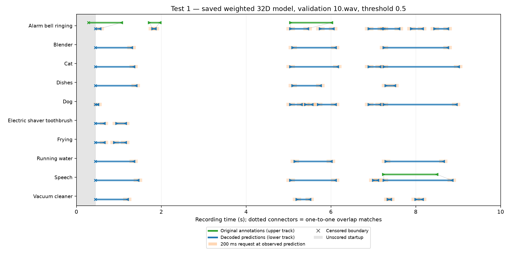
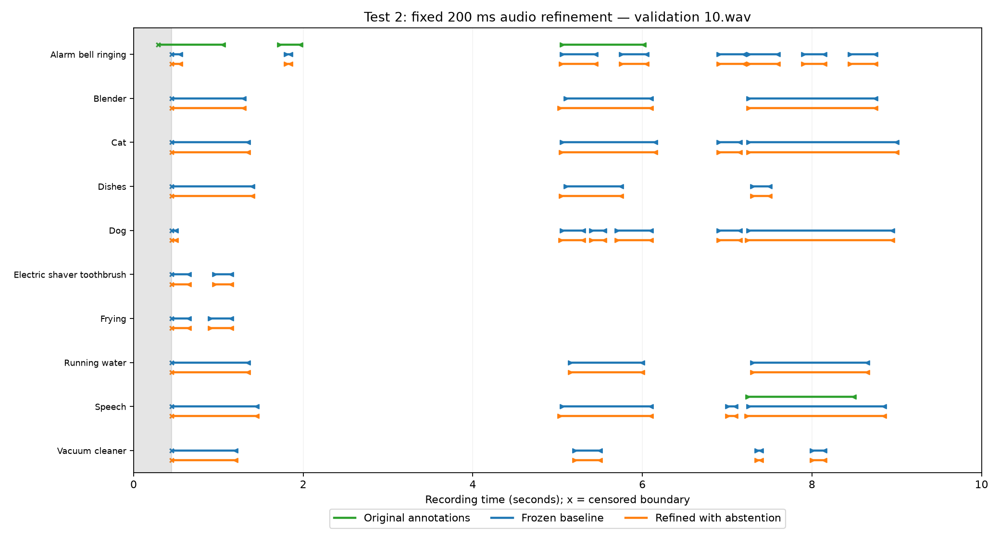

# Offline feasibility report — November 2, 2026

Offline experiments for the M202A embedded audio project, completed November 2, 2026. The objective is to predict sound activity from compact learned features, then optionally retrieve a short raw-audio segment to refine event boundaries.

**Result:** the CNN + GRU pipeline trains successfully, but detection precision is low. A 200 ms audio-refinement branch modestly improved boundary timing. It did not outperform a feature-context-only correction head on overall matched-boundary MAE, and event-detection scores did not improve.

This report preserves the original feasibility snapshot. The repository has since been reorganized; the measurements below have not been rerun. It includes the core model and dataset definitions, rather than the complete training/evaluation pipeline. Audio, checkpoints, caches, experiment runners, and detailed logs are not included.

## Core code

| File | Role |
|---|---|
| [audio_dataset.py](../data/audio_dataset.py) | Individual audio windows and overlap-based activity targets |
| [sequence_dataset.py](../data/sequence_dataset.py) | Chronological window sequences from the same recording |
| [models.py](../models/activity.py) | Window CNN and causal GRU activity model |
| [boundary_refinement.py](../models/boundary_refinement.py) | Optional audio/context refinement head and abstention policy |

These files are unchanged copies of the experiment implementations. The dataset classes expect the original local `processed_audio/wav/`, `processed_audio/recording_splits.csv`, `processed_audio/classes.txt`, and `Synthetic_dataset/synthetic_dataset.csv` inputs. They are not a standalone rerun script.

## Shared setup

- Audio: 16 kHz mono; 500 ms windows; 50 ms hop; no startup audio padding.
- Targets: ten independent activity labels for the latest 50 ms. A class is positive when an original event overlaps that interval.
- Model 1: fixed log-spectrogram frontend and a small CNN producing 32 or 128 learned features.
- Model 2: unidirectional GRU with 32 hidden units and ten activity outputs. State resets between recordings.
- Existing recording-level splits and class ordering were preserved. Random seed: 2026. Activity threshold: score >= 0.5.
- The first output arrives at 0.50 s and labels [0.45, 0.50) s. The first 450 ms is unscored, giving approximately 95.5% coverage of each 10-second recording.

## CNN + GRU feasibility baseline

Both models were trained jointly for 20 epochs on 128 training recordings and evaluated on 32 separate validation recordings: 24,448 training frames and 6,112 validation frames. Adam learning rate was 0.001, with four recordings per batch. The checkpoint with lowest unweighted validation BCE was selected.

Unweighted training produced all-negative predictions. A separate weighted run used positive weights `(negative training frames) / (positive training frames)` for each class, calculated only from the selected training targets.

| Predictor | Validation BCE | Micro precision | Micro recall | Frame-level micro F1 |
|---|---:|---:|---:|---:|
| Constant training class frequencies | 0.1701 | 0.0000 | 0.0000 | 0.0000 |
| 32D weighted CNN + GRU | 0.4572 | 0.1252 | 0.7346 | 0.2139 |
| 128D weighted CNN + GRU | 0.4132 | 0.1387 | 0.7247 | 0.2329 |

BCE above is unweighted for comparability. Micro metrics pool all frame/class decisions: precision = TP/(TP+FP), recall = TP/(TP+FN), F1 = 2TP/(2TP+FP+FN). Undefined ratios are zero. The constant predictor uses only training class frequencies; all are below the 0.5 threshold. Weighted sigmoid scores are not calibrated probabilities. Weighting improved F1 while increasing unweighted BCE and producing many false positives.

Model 1 has **5,376 parameters / 21.00 KiB FP32 weights** at 32D and **17,760 parameters / 69.38 KiB** at 128D. Each also has 1,856 bytes of fixed buffers. These figures exclude activation memory and FFT workspace.

## Test 1: initial event boundaries

The weighted 32D epoch-19 predictions were reused. For each recording and class, consecutive frames with score >= 0.5 form one event. The first interval start is the onset; the last interval end is the offset. No smoothing, gap filling, or annotation-based adjustment is used.

Predicted and annotated events are matched one-to-one within the same recording and class. Matching requires positive overlap, maximizes pair count, then total intersection-over-union. Different classes can overlap independently; fragments and merged events receive no duplicate credit.

There were **762 predicted events and 79 annotations: 69 matches, 693 unmatched predictions, and 10 missed events**. Overlap-based event precision was **9.06%**, recall **87.34%**, and F1 **16.41%**. These permissive overlap scores do not imply accurate boundaries.

For each predicted endpoint, a simulated 200 ms raw-audio request was centered on the prediction, never on an annotation. A capture requires the corresponding true boundary to lie within +/-100 ms. Startup-censored and endpoint-censored boundaries are excluded from timing accuracy and capture credit; requests and missed events remain in the accounting.

| Boundary | Eligible matched pairs | Mean absolute error | Captured among eligible matches | Captured among all eligible true boundaries |
|---|---:|---:|---:|---:|
| Onset | 63 | 278.0 ms | 34/63 (54.0%) | 34/73 (46.6%) |
| Offset | 54 | 499.4 ms | 10/54 (18.5%) | 10/63 (15.9%) |

Six annotated onsets and sixteen annotated offsets were censored. There were 1,524 nominal boundary requests, including 1,386 from unmatched predictions.

## Test 2: fixed 200 ms audio refinement

The initial 32D CNN + GRU was frozen. A small refinement head combined requested audio with the frozen CNN features and GRU state available at the boundary decision time, plus class and onset/offset identity. It predicted a correction bounded to +/-100 ms and a support score. Low support or invalid corrections retained the original estimate.

Refinement used 256 recordings from the existing training split that were unused by baseline fitting: **192 fitting / 64 development**. Both the audio/context head and a context-only control were trained for 30 epochs. Checkpoint and gate selection used the development recordings only, then were locked before validation evaluation. The audio head selected epoch 13 and gate 0.8; the control selected epoch 8 and gate 0.6. The original activity threshold remained 0.5.

The fitting set contained 279 supported requests and 8,640 unsupported requests. Some categories were very sparse, including no supported vacuum-cleaner offsets. Validation contained only 34 captured onsets and 10 captured offsets.

All comparisons below use identical initial event pairs and censoring exclusions. Abstentions remain in the denominator; these are not accepted-only results.

| Population | Boundary | Cases | Initial MAE | Audio + context MAE | Context-only MAE |
|---|---|---:|---:|---:|---:|
| True boundary captured | Onset | 34 | 47.6 ms | 33.7 ms | 35.4 ms |
| True boundary captured | Offset | 10 | 53.5 ms | 44.5 ms | 47.8 ms |
| All eligible matched pairs | Onset | 63 | 278.0 ms | 269.0 ms | 268.2 ms |
| All eligible matched pairs | Offset | 54 | 499.4 ms | 495.7 ms | 493.9 ms |

Across the 117 eligible matched boundaries, audio refinement improved 23, worsened 5, and left 89 unchanged. Overall MAE changed from **380.2 to 373.6 ms**; the context-only control reached **372.4 ms** without additional raw-audio requests.

Event detection remained unchanged: **69 matches, 693 unmatched predictions, 10 missed events**. Including all eligible annotated boundaries, not just matched ones, the number within 100 ms increased from 44/136 to 46/136 with audio refinement. Missed events and censored-prediction failures stay in that denominator.

The stricter complete-event subset also remained unchanged: 17 matches among 626 predicted and 57 reference events, precision 2.72%, recall 29.82%, F1 4.98%. This subset requires both boundaries to be observed, with onset error <=200 ms and offset error <=max(200 ms, 20% of reference duration). Predictions associated with excluded censored references are also excluded; this is not a full DESED benchmark score.

**Request cost:** 1,382 complete requests at 3,200 mono PCM16 samples each, totaling **8,844,800 bytes**. Of those, 1,263 requests came from unmatched events. Censored predictions and incomplete segments abstained before retrieval. Learned rejection after inspecting audio did not refund request bytes. Payload excludes metadata, transport headers, and retries.

## Interpretation and limits

The pipeline is a working offline feasibility experiment. The raw-audio branch improved timing on some captured boundaries, but the overall evidence does not show an advantage over the context-only correction head. Detection quality and request coverage remain the main limitations.

Only ten captured offsets were available, and the audio head corrected two of them. Results use a small synthetic validation subset, one seed, and strongly overlapping windows. The baseline checkpoint previously used validation for selection; the new refinement heads did not use validation for fitting or gate selection. The test set remained untouched.

No 400 ms ablation was run. MCU runtime, BLE transmission, power, memory fit, and deadline performance have not been verified. The full local experiment artifacts retain logs, checkpoints, configurations, prediction arrays, and verification audits; this upload intentionally contains only the core code and summarized evidence.
