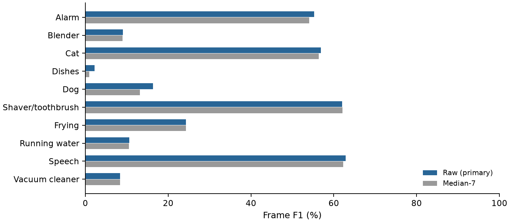
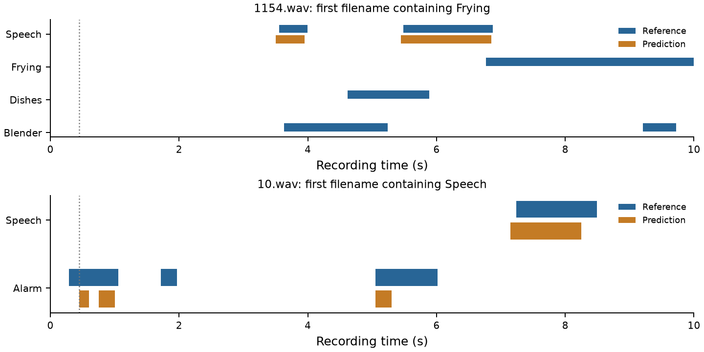

# DCASE2019 full-corpus pretrained BiGRU report

P13 - Junchi Chen and Wei Zhang - November 7, 2026

[Printable PDF](pretrained_full_report.pdf)

The full-corpus raw frame micro F1 is 41.10%; precision 84.79%, recall 27.13%. This establishes a reproducible offline reference, not a completed online system.

## Scope and methods

- All 2,045 WAV files; 6,032 source event annotations; no quality-based exclusions. Nominal audio: 20,450 s (5.68 h). Scored targets: 390,595; first 450 ms of each file unscored. All source files are 44.1 kHz mono.
- Frozen official DCASE 2023 plain CNN+BiGRU student, 1,112,420 parameters. Original audio resampled to 16 kHz; official 128-bin mel, dB and instance normalization. No model training or threshold fitting. Primary threshold >=0.5; raw and median-7 both reported.
- Frame targets are 50 ms, positive for any annotation overlap. Assign the official 64 ms score bin containing each target midpoint. Event matching is same-class positive overlap, maximum pair count then IoU; it is permissive, not collar F1 or PSDS. Only references intersecting [0.45, 10) s enter event scoring; 23 earlier-only events are excluded.
- Boundary MAE is conditional on matched events. Exclude reference onsets <=0.45 s and offsets >=10 s from timing errors; false/missed events remain in event F1. Source-duration rounding of up to two samples was corrected in 166 files.

Source channels: `{'1': 2045}`; sample rates: `{'44100': 2045}`.

## Results

| Metric | Raw, primary | Median-7 |
|---|---:|---:|
| Frame micro precision | 84.79% | 84.92% |
| Frame micro recall | 27.13% | 26.62% |
| Frame micro F1 | 41.10% | 40.53% |
| Frame macro F1 | 30.80% | 30.11% |
| Event overlap micro F1 | 56.74% | 54.05% |
| Matched onset MAE | 266.4 ms (n=2666) | 244.7 ms (n=2300) |
| Matched offset MAE | 372.6 ms (n=2364) | 338.8 ms (n=2015) |

Raw frame counts: 53,336 TP, 9,571 FP, 143,286 FN. Raw event counts: 2,811 matches, 1,088 false predictions, 3,198 misses.

## Per-class frame results

| Class | Precision | Recall | F1 | Positive frames |
|---|---:|---:|---:|---:|
| Alarm bell ringing | 65.31% | 47.89% | 55.26% | 16646 |
| Blender | 77.11% | 4.80% | 9.04% | 28200 |
| Cat | 90.90% | 41.41% | 56.90% | 12020 |
| Dishes | 45.06% | 1.13% | 2.21% | 10072 |
| Dog | 94.37% | 8.93% | 16.32% | 10511 |
| Shaver/toothbrush | 81.50% | 50.11% | 62.06% | 20892 |
| Frying | 85.33% | 14.19% | 24.33% | 13855 |
| Running water | 79.12% | 5.69% | 10.62% | 12314 |
| Speech | 94.69% | 47.02% | 62.83% | 50863 |
| Vacuum cleaner | 100.00% | 4.38% | 8.39% | 21249 |



Lowest raw class F1: Dishes 2.21%, Vacuum_cleaner 8.39%, Blender 9.04%. Highest: Speech 62.83%, Electric_shaver_toothbrush 62.06%, Cat 56.90%. Median filtering changes frame micro F1 by -0.57 percentage points. A change in matched-boundary MAE can also reflect a different matched population. All ten classes have nonzero F1 on the full corpus; zero F1 in the smaller pilot did not imply the model could never detect those classes.

## Example timelines



Examples `1154.wav` and `10.wav` are the first filenames containing Frying and Speech respectively (second file distinct), chosen from annotations, not model performance. Blue is ground truth; orange is raw prediction. The dotted line marks the start of scored intervals at 0.45 s.

## Computation time

CPU, four threads, one warm-up: median 28.0 ms, p95 41.9 ms per ten-second input. This includes mel/dB/normalization/network, not end-to-end report latency. Hardware/OS and all measured calls are retained in the metrics artifact.

## Interpretation and limits

- These are public synthetic training recordings, not an independent official test set. Overlap with the pretrained model's training material has not been audited. The original custom-model validation list and weights remain unavailable.
- BiGRU, centered STFT, whole-window normalization and symmetric smoothing use future context. Compute time excludes audio collection, resampling, transfer, queueing and event decoding. This is not a deadline-aware or MCU measurement.
- The dataset is suitable for single-channel overlapping-event detection, but not direction localization. Nano 33 BLE Sense / Rev2 has one onboard microphone. Real board recordings are still needed to evaluate microphone, room and noise differences.
- Do not claim a gain over the old 21.39%/23.29% custom-model frame F1: those used a different 32-recording subset, training setup and causal context. Future threshold/model choices need separate development data and a fresh evaluation set.

## Reproduce

```bash
python scripts/fetch_dcase_pilot.py --all
python -m scripts.evaluate_pretrained --all
python scripts/report_pretrained.py
```

Inference dependencies: `requirements-pretrained.txt`; report dependencies: `requirements-report.txt`. Original pilot outputs are preserved. Full details remain in ignored `output/pretrained_full/`.

## Evidence and sources

- [Full metrics](../results/pretrained_full_metrics.json)
- [All filenames and WAV hashes](../results/pretrained_full_manifest.csv)
- [Per-class counts](../results/pretrained_full_per_class.tsv)
- [Dataset](https://zenodo.org/records/2583796)
- [Official model recipe](https://github.com/DCASE-REPO/DESED_task/tree/master/recipes/dcase2023_task4_baseline)
- [Checkpoint](https://zenodo.org/records/7759146)
- [Nano Rev2 hardware](https://docs.arduino.cc/hardware/nano-33-ble-sense-rev2)

Archive MD5: `06ebea7cc467ace800752bd21ec7178d`; checkpoint SHA256: `16a7f4cef26265ce68623bc275a0dac0cdac1d0aa72c1ace4d89ff6c4d5fc4ce`. Pinned model code: `c6bcb45b8b986ccde5c56bb86eefaf9d19b2320c`. All archive members were CRC-checked. No model weights or raw audio are committed.
